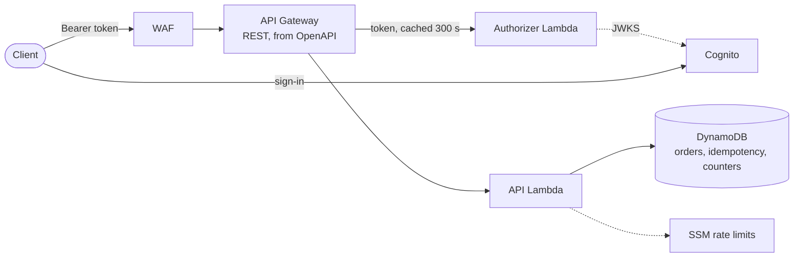

# Task 1: Orders API

[](https://github.com/ehmSKah/task-submission/actions/workflows/ci.yml)

A REST API for orders, with Amazon Cognito authentication, role-based authorization
(`USER`, `ORDER_MANAGER`, `ADMIN`) and per-IP and per-user rate limits. It is serverless:
- **API Gateway:** a REST API (edge-optimized) built from the OpenAPI document, with a WAF
  rate rule in front.
- **Lambda:** a token authorizer and one Python function.
- **DynamoDB:** orders, idempotency records and rate-limit counters.
- **SSM Parameter Store:** the rate limits, changeable at runtime.

The whole stack runs locally on the [Floci](https://github.com/floci-io/floci) AWS emulator with
one command, and the same AWS CDK stack deploys unchanged to AWS. The reasoning is in
[`docs/design.md`](docs/design.md), which summarises the decisions in
[`docs/adr/`](docs/adr/).

## Deliverables at a glance

| Assignment item | Where |
|---|---|
| **REST API:** `POST`/`GET /api/v1/orders`, `GET`/`DELETE /api/v1/orders/{id}`, `PATCH /api/v1/orders/{id}/status`, `GET /api/v1/health` | [`openapi/openapi.yaml`](openapi/openapi.yaml) (the contract and the gateway definition); [`api_handler.py`](src/orders_api/adapters/inbound/api_handler.py) (routes); [`application/orders.py`](src/orders_api/application/orders.py) (use cases) |
| **Cognito access-token validation:** signature, issuer, expiry, client | [`auth/tokens.py`](src/orders_api/auth/tokens.py) (the nine checks); [`auth/oidc.py`](src/orders_api/auth/oidc.py) (discovery and JWKS cache); [`authorizer_handler.py`](src/orders_api/adapters/inbound/authorizer_handler.py); [design §3](docs/design.md#3-authentication); [ADR 0003](docs/adr/0003-access-token-validation.md) |
| **RBAC:** USER sees only their own orders; ORDER_MANAGER; ADMIN | [`domain/permissions.py`](src/orders_api/domain/permissions.py); [`domain/access.py`](src/orders_api/domain/access.py) (groups to roles); [design §4](docs/design.md#4-authorization); [ADR 0001](docs/adr/0001-role-based-access-control.md) |
| **Rate limits per user and per IP, configurable, `429`** | [`domain/rate_limits.py`](src/orders_api/domain/rate_limits.py); [`application/rate_limiting.py`](src/orders_api/application/rate_limiting.py); [`ssm_rate_limits.py`](src/orders_api/adapters/outbound/ssm_rate_limits.py) (runtime config); [`waf.py`](infra/orders_api_infra/waf.py) (edge); [design §5](docs/design.md#5-rate-limiting); [ADR 0006](docs/adr/0006-rate-limiting.md) |
| **Validation with consistent errors** | The OpenAPI schemas (enforced by the gateway and again in [`contract/`](src/orders_api/contract/__init__.py)); [`request_checks.py`](src/orders_api/adapters/inbound/request_checks.py); [`problems.py`](src/orders_api/adapters/inbound/problems.py) (RFC 9457); [design §6](docs/design.md#6-validation-and-errors); [ADR 0007](docs/adr/0007-validation-and-errors.md) |
| **Tests: successful requests** | [`tests/integration/test_successful_requests.py`](tests/integration/test_successful_requests.py); unit: [`test_create_order_route.py`](tests/unit/test_create_order_route.py) and the other `*_route.py` |
| **Tests: invalid tokens** | [`tests/integration/test_invalid_tokens.py`](tests/integration/test_invalid_tokens.py); unit: [`test_token_validator.py`](tests/unit/test_token_validator.py) (each check on its own) |
| **Tests: authorization failures** | [`tests/integration/test_authorization_failures.py`](tests/integration/test_authorization_failures.py); unit: [`test_authorization_failures.py`](tests/unit/test_authorization_failures.py), [`test_permissions.py`](tests/unit/test_permissions.py) |
| **Tests: rate limiting** | [`tests/integration/test_rate_limiting.py`](tests/integration/test_rate_limiting.py), [`test_ip_rate_limiting.py`](tests/integration/test_ip_rate_limiting.py); unit: [`test_rate_limiter.py`](tests/unit/test_rate_limiter.py), [`test_fail_open_counters.py`](tests/unit/test_fail_open_counters.py) |
| **Tests: invalid input** | [`tests/integration/test_invalid_input.py`](tests/integration/test_invalid_input.py); unit: [`test_order_requests.py`](tests/unit/test_order_requests.py) |
| **Deliverable: README with setup and execution instructions** | This file: [Quick start](#quick-start), [Tests](#tests), [Running against AWS](#running-against-aws-optional) |
| **Deliverable: unit and integration tests** | [`tests/unit/`](tests/unit/), [`tests/integration/`](tests/integration/), plus [`tests/adapter/`](tests/adapter/) and [`tests/contract/`](tests/contract/) ([Tests](#tests)) |
| **Deliverable: OpenAPI / Swagger** | [`openapi/openapi.yaml`](openapi/openapi.yaml); `make docs` serves it in Swagger UI |
| **Deliverable: brief documentation of the authentication, authorization and rate-limiting strategy and key design decisions** | [`docs/design.md`](docs/design.md) (about six pages), with the ADRs in [`docs/adr/`](docs/adr/) and the glossary in [`CONTEXT.md`](CONTEXT.md) |
| **Local Cognito, demo users and tokens** | Floci's Cognito, deployed by `make up`; [Users and roles](#users-and-roles) |

## Quick start

Needs Docker, `make`, `uv` and Node.js ([versions](#tools)); no AWS account.

```sh
git clone <this repository> && cd <clone>/task1
make doctor   # checks the tools and their versions
make up       # installs dependencies, starts Floci, deploys the stack, seeds the demo users
make demo     # the one-minute scenario below, against the deployed stack
make test     # unit tests (they need no stack; `make install && make test` works on its own)
make down     # stops Floci and removes everything
```

The first `make up` takes a few minutes: it pulls the Floci image, installs the Python and Node
dependencies and deploys with CDK. It ends by printing the local API URL, which is also in
`build/endpoints.json`.

`make demo` prints every request and its status, and fails on the first status that isn't the
expected one. It never prints a token.

| # | What it shows | Expected |
|---|---|---|
| 1 | `GET /api/v1/health` without a token | `200` |
| 2 | alice (USER) creates two orders | `201`, `201` (with `ETag` and `RateLimit-*`) |
| 3 | bob (USER) asks for alice's order | `404`: other people's orders look like missing ones |
| 4 | alice cancels one order; the manager confirms and ships the other; alice then tries to cancel the shipped one | `200`, `200`, `200`, `409` |
| 5 | alice deletes an order, then the admin does | `403`, `204` |
| 6 | a body with an unknown field (`totalAmount`) | `400` from the gateway's validator |
| 7 | a forged `alg: none` token made from alice's real one | `401` |
| 8 | preset `tiny` switched in at runtime; alice lists her orders four times | `200`, `200`, `200`, `429` with `Retry-After`; the previous limits are restored afterwards, also on failure |

It takes 10–20 seconds. It empties the rate-limit counters so its counts are its own, and it
needs an environment with test fixtures (`local` or `aws-dev`).

### Tools

| Tool | Version | Why |
|---|---|---|
| Docker with Compose | Docker 24+, Compose 2.20+ | Runs Floci and the Lambda containers it starts |
| `make` | 3.81+ | Every setup and execution step |
| [`uv`](https://docs.astral.sh/uv/) | 0.8+ | Python tooling; installs Python 3.13 itself (pinned in `.python-version`) |
| Node.js and npm | Node 20+, npm 10+ | The AWS CDK CLI (2.1145.0) and Spectral, pinned in `infra/package.json` |
| `jq` (optional) | any | Only for the `curl` examples below |

Tested on Linux (x86_64 in CI, aarch64 locally) with Floci 2.3.0, pinned in
`docker-compose.yml`. `make help` lists every target.

## Architecture at a glance



Invalid traffic is stopped as early as possible:
- floods at WAF
- bad tokens at the authorizer
- invalid bodies at the gateway

The API function counts the rate limits, checks the request and the caller's permission, and
writes with conditional updates. The request flow, step by step, is in
[design §2](docs/design.md#2-request-flow).

## API

| Method and path | Who | Success |
|---|---|---|
| `GET /api/v1/health` | anyone, no token | `200` |
| `POST /api/v1/orders` | any role; the owner is always the caller | `201`, `ETag`; optional `Idempotency-Key` |
| `GET /api/v1/orders?limit=&cursor=` | own orders; staff see all | `200`, `{ items, nextCursor }`, newest first |
| `GET /api/v1/orders/{id}` | the owner, or staff | `200`, `ETag` |
| `PATCH /api/v1/orders/{id}/status` | the owner may cancel; `ORDER_MANAGER` and `ADMIN` may make any allowed change | `200`; optional `If-Match` |
| `DELETE /api/v1/orders/{id}` | `ADMIN` | `204` |

- **Auth:** every order operation needs `Authorization: Bearer <Cognito access token>`.
- **Errors:** RFC 9457 Problem Details (`application/problem+json`), with a stable `type` URN
  and a `requestId`, whichever layer answers.
- **Rate limits:** every counted response carries `RateLimit-Limit`, `RateLimit-Remaining` and
  `RateLimit-Reset`.
- **The contract:** [`openapi/openapi.yaml`](openapi/openapi.yaml) documents every status each
  operation can return. `make docs` serves it in a read-only Swagger UI on
  <http://localhost:8080>. There is no "Try it out", because that would need CORS; use the
  [request collection](#trying-requests) instead.

## Users and roles

`make up` seeds five demo users into the stack's Cognito user pool. Their one shared password is
generated by CDK into Secrets Manager (`/orders-api/<env>/seed-users`) and never appears in the
repository.

| User | Group (role) | Shows |
|---|---|---|
| `alice@example.test` | `USER` | an owner: creates, reads and cancels her own orders |
| `bob@example.test` | `USER` | a second owner: can't see alice's orders |
| `manager@example.test` | `ORDER_MANAGER` | reads every order, makes any allowed status change |
| `admin@example.test` | `ADMIN` | everything, including delete |
| `nobody@example.test` | none | a valid token without a role: `403` everywhere |

`make token` prints an access token: `ROLE=user|manager|admin|none` (alice, manager, admin,
nobody) or `USER_NAME=alice|bob|manager|admin|nobody`. Tokens are valid for 15 minutes.

```sh
API=$(jq -r .apiUrl build/endpoints.json)
curl -i "$API/api/v1/health"
curl -i -H "Authorization: Bearer $(make -s token ROLE=user)" "$API/api/v1/orders"
```

## Trying requests

[`http/`](http/) holds a request collection in the JetBrains HTTP Client format:
- [`orders.http`](http/orders.http): the happy paths
- [`errors.http`](http/errors.http): every kind of refusal, each with the status it expects
- [`rate-limit.http`](http/rate-limit.http): `429` after `make limits PRESET=tiny`

```sh
make http-env   # writes http/http-client.private.env.json: baseUrl and a token per demo user
```

- **Running it:** open the files in IntelliJ IDEA or PyCharm (built in) or in VS Code with the
  httpyac extension, and pick the environment `local`. The httpyac CLI works too:
  `npx httpyac send http/orders.http --env local --all`. The VS Code REST Client extension uses
  a different environment and script syntax and isn't supported.
- **The environment file** is git-ignored and readable by you only.
- **Tokens expire after 15 minutes.** Run `make http-env` again for fresh ones; it keeps any other
  environment in the file (e.g. `aws-dev`).

## Tests

| Suite | Command | Runs against | Proves |
|---|---|---|---|
| Unit | `make test` | plain Python, in-memory fakes | domain rules, each token check on its own, the permission matrix, rate-limit decisions and the fail-open store, the request pipeline, Problem Details, the CDK stack (cdk-nag), the demo and doc checks |
| Adapter | `make test-adapter` | the real DynamoDB, SSM and WAF APIs on Floci | conditional writes, both indexes and cursor stability, the atomic counter, the config source, idempotency persistence |
| Integration | `make test-integration` | the deployed stack over HTTP | the five assignment categories end to end; every response validated against the OpenAPI document |
| Contract | `make contract-test` | the deployed stack | Schemathesis: about 1,500 generated requests, no `5xx`, only documented statuses, headers and bodies |
| Static | `make lint` | the repository | Ruff, mypy (strict), import-linter (no AWS in the domain), OpenAPI lint (openapi-spec-validator, Spectral), actionlint, cdk-nag for every environment |

- **Order:** the unit suite needs nothing deployed. The others need `make up` first, and run one
  after another because they switch the runtime rate limits.
- **Markers:** `floci_only` (second-long tokens) and `aws_only` (WAF enforcement, the client
  address behind the edge) skip themselves on the other target.
- **Coverage:** `make test` then `make coverage` (add `make test-adapter` in between for both
  suites) enforces **≥ 95 %** for `domain`, `application` and `auth`, and **≥ 85 %** overall,
  branches included. It writes XML and HTML reports to `build/`.
- **Pass arguments to pytest:** `make test PYTEST_ARGS="-k token -x"`.

**CI** ([`.github/workflows/ci.yml`](../.github/workflows/ci.yml), on every push):
1. **`static`:** `make lint`.
2. **`unit`:** the unit suite with the coverage gates.
3. **`floci`:** `make up` on a fresh runner, then the adapter, integration and contract suites
   and `make demo`.

Reports are uploaded only after a check that they contain no token. The
[`aws-e2e`](../.github/workflows/aws-e2e.yml) workflow is the same against AWS, on a manual
trigger only ([below](#running-against-aws-optional)).

## Configuration

- **Environments:** each has a typed config file in [`infra/config/`](infra/config/), selected
  with `ENV` (default `local`):
  - `local`: Floci.
  - `aws-dev`: disposable AWS, with demo users and test fixtures.
  - `aws-prod`: the hardened example. Data is retained, the stack is termination protected, and
    there are no demo users.
- **What differs between them:** Lambda architecture, log level and retention, the rate-limit
  cache time, WAF limits, access logs and removal policies
  ([ADR 0010](docs/adr/0010-infrastructure-and-environments.md)).

**Rate limits are runtime configuration** ([ADR 0006](docs/adr/0006-rate-limiting.md)). They
live in one SSM parameter, `/orders-api/<env>/rate-limits`, which `make limits` switches without
a deploy. The change is in force within the cache time: 2 s locally and in `aws-dev`, 60 s in
`aws-prod`.

| `make limits PRESET=…` | Per IP | Per user: `USER` / staff | Use |
|---|---|---|---|
| `defaults` | 300 | 60 / 300 | ADR 0006's limits, what `make up` deploys |
| `high` | 100,000 | 100,000 | the test suites (one address sends everything locally) |
| `tiny` | 30 | 3 / 5 | see a user's `429` quickly |
| `tiny-ip` | 3 | 10 | see the IP's `429` quickly |

Limits are per minute, in fixed windows. An invalid value is rejected by the function, which
keeps the last good limits.

## Running against AWS (optional)

The same targets run against a real AWS account with `ENV=aws-dev`, using your own credentials
(a profile or SSO). No Floci is involved. Before the first deploy, the account needs a one-off
setup: CDK's bootstrap and API Gateway's CloudWatch Logs role.
[`docs/aws.md`](docs/aws.md) describes it, along with the workflow's OIDC role and its
permissions.

```sh
export AWS_PROFILE=<your profile>
make doctor ENV=aws-dev             # tools, credentials, the account's one-off setup
make up ENV=aws-dev                 # bootstrap (idempotent), deploy, seed the demo users
make demo ENV=aws-dev
make test-integration ENV=aws-dev   # including the aws_only tests (WAF, the client address)
make contract-test ENV=aws-dev
make down ENV=aws-dev               # cdk destroy
```

- **Guard:** every target refuses to run if the shell would send it to the wrong place, such as
  an emulator endpoint, Floci's dummy key or another region.
- **`aws-e2e` workflow:** deploys `aws-dev` through GitHub OIDC (no stored keys), runs both
  suites, and always destroys the stack. It runs on a manual trigger only.
- **Cost:** mostly pay per request.
  - WAF charges $5 a month per web ACL and $1 per rule, pro rata by the hour, so about a cent
    per hour `aws-dev` is up.
  - The demo users' secret is $0.40 a month, pro rata.
  - The edge-optimized endpoint adds a few minutes to deploy and destroy.
  - The cost at scale is in [design §8](docs/design.md#cost-model).
- **Status:** nothing has been run on AWS yet. The AWS rows of
  [`docs/verification.md`](docs/verification.md) are `pending` until the first run.

## Project layout

```
task1/
├── openapi/openapi.yaml      # the contract; the gateway is built from it
├── src/orders_api/           # the shipped package (hexagonal, ADR 0009)
│   ├── domain/               # orders, statuses, permissions, rate-limit rules; no AWS imports
│   ├── application/          # use cases and ports; the rate limiter and its fail-open store
│   ├── auth/                 # the OIDC token validator and JWKS cache; no Lambda imports
│   ├── contract/             # request schemas loaded from openapi.yaml
│   └── adapters/             # inbound: Lambda handlers; outbound: DynamoDB, SSM
├── infra/                    # CDK app, environment configs, and the make helpers:
│   └── orders_api_infra/     #   stack, demo users, limits, demo, http-env, endpoints
├── tests/                    # unit/, adapter/, integration/, contract/
├── http/                     # the .http request collection
├── docs/                     # design.md, adr/, verification.md, aws.md
├── scripts/                  # doctor and wait-for-Floci helpers
├── docker-compose.yml        # Floci (pinned) and Swagger UI
├── Makefile                  # every setup and execution step; `make help`
└── CONTEXT.md                # the domain glossary
```

## Known limitations and deliberate omissions

These are stated rather than hidden. The full list, with what would change each one, is in
[design §9](docs/design.md#9-known-limitations-and-verification-items) and
[ADR 0013](docs/adr/0013-production-readiness-and-evolution.md).

- **Not built:** metrics, tracing, alarms and dashboards; logs carry every signal
  ([ADR 0012](docs/adr/0012-observability-and-security-baseline.md)). There is no CORS (no
  browser clients) and no hosted docs.
- **Simplified:**
  - Clients set unit prices; there is no catalogue.
  - Sign-in is by password, for the demo and tests; production would use authorization code
    with PKCE.
  - List filters and sorting are not offered.
- **Locally, WAF is deployed but not enforced,** and every request comes from one Docker
  address. Per-IP behaviour is therefore proven by unit tests, and on AWS by the `aws_only`
  tests.
- **Security trade-offs, bounded:**
  - A token that expires after a cached Allow works for up to 5 more minutes.
  - Revocation and role changes take effect when the token expires (15 minutes).
  - Fixed windows allow a 2× burst at a minute boundary.
- **Not yet verified on AWS:** see [`docs/verification.md`](docs/verification.md).

## Troubleshooting

- **Something is missing or too old:** `make doctor` names it.
- **A URL stopped working after `make up`:** the REST API id changes on every deploy and can't
  be pinned on Floci. `make up` writes the current URL to `build/endpoints.json`, which every
  tool reads. Run `make http-env` again for the request collection.
- **The first request after `make up` is slow (10 s or more):** Floci pulls the Lambda base
  image on the first invoke. Pull it beforehand with
  `docker pull public.ecr.aws/lambda/python:3.13`.
- **`ImportError` from `cryptography` in the function logs:** the bundle was built for another
  CPU architecture. Locally it follows the host, because Floci runs Lambda on the host's
  architecture. Run `make deploy` to rebuild it.
- **A redeploy fails with change-set errors:** deploy through `make deploy`, which uses
  `cdk deploy --method=direct`. Floci breaks CDK's default change-set deploys.
- **`make demo` fails at step 2 with `429`:** limits from an interrupted test run are still in
  force. Run `make limits PRESET=defaults`.
- **`401` with a token that worked earlier:** tokens last 15 minutes. Run `make token` or
  `make http-env` again.
- **Port 4566 or 8080 is in use:** stop whatever holds it. `make down` also removes Floci's
  Lambda containers left from an earlier run.
- **Starting from scratch:** run `make down && make up`. Floci keeps everything in memory, so
  each `make up` deploys and seeds afresh.
