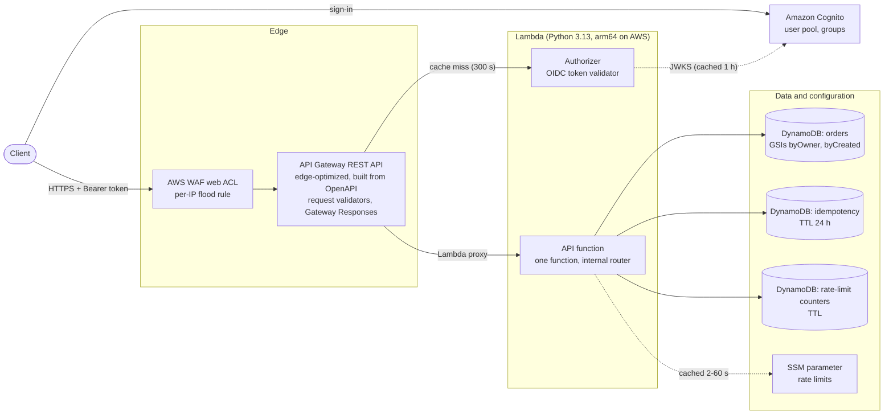
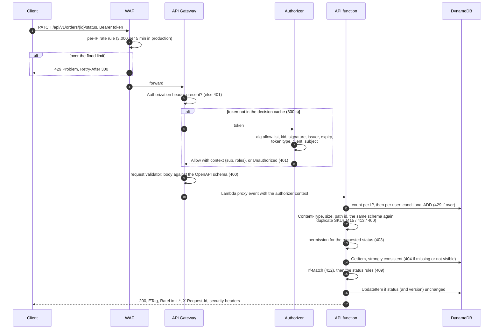

# Orders API: design

This document covers the authentication, authorization and rate-limiting strategy and the key
design decisions. Each section summarises one or more decisions and links to the ADR that holds
the reasoning, the alternatives and the details. The ADRs ([`adr/`](adr/)) and the glossary
([`CONTEXT.md`](../CONTEXT.md)) go into more depth. What has been proven, and on which target,
is in [`verification.md`](verification.md).

## 1. Overview

An orders REST API with six operations: create, list, read, change status, delete, and a
public health check. Callers sign in with Amazon Cognito and send an access token. Their roles
(`USER`, `ORDER_MANAGER`, `ADMIN`) decide what they may do, and requests are rate limited per
client IP and per user.

**Constraints that shaped the design:**
- It runs end to end on a laptop, on the Floci AWS emulator, with no AWS account.
- The same CDK stack deploys unchanged to AWS (`ENV=aws-dev`, [`aws.md`](aws.md)).
- The identity provider must be swappable: Cognito today, any OpenID Connect provider tomorrow.
- Pay per request, nothing to patch, scale to zero.

**Code** ([ADR 0009](adr/0009-code-structure.md)) is one hexagonal Python package. The domain,
use cases and the token validator have no AWS imports, and import-linter enforces that in CI.
AWS lives in adapters, so a move to containers or another identity provider means a new adapter,
not a rewrite.

**Operational and security baseline** ([ADR 0012](adr/0012-observability-and-security-baseline.md)):
- **Logs:** structured JSON lines with the request id, which is also in the `X-Request-Id`
  header and in every error body. Each line also carries the route, `sub`, roles, status and
  latency, and fixed event names for operational signals.
- **Data minimisation:** client IPs in application logs are truncated (IPv4 `/24`, IPv6 `/64`).
  Tokens, secrets and bodies are never logged. WAF sampled requests are off, because samples
  would keep the bearer token.
- **Least-privilege IAM:** hand-written statements on exact ARNs, with no `Scan` or batch
  actions, and each function invocable only by this API. `cdk-nag` checks every environment at
  synth.
- **Security headers** on every response from every layer: `Cache-Control: no-store`,
  `X-Content-Type-Options: nosniff`, `Content-Security-Policy: default-src 'none';
  frame-ancestors 'none'`, `X-Frame-Options: DENY` and `Strict-Transport-Security`.
- **CORS only for the browser origins an environment lists**
  ([ADR 0014](adr/0014-cors-for-browser-clients.md)): Swagger UI's `http://localhost:8080` in
  `local` and `aws-dev`, none in `aws-prod`, where nothing changes. API Gateway answers the
  preflight itself (a MOCK integration, no token, no function); the function echoes an allowed
  origin on its responses; Gateway Responses and WAF's `429` carry it as a static value. Never
  `*`, never credentials. The published contract lists no `OPTIONS`.

## 2. Request flow

The order of the checks decides which error a client sees when several things are wrong
([ADR 0009](adr/0009-code-structure.md)). One `PATCH /api/v1/orders/{id}/status`:

- **Invalid traffic stops as early as possible.** Floods stop at WAF, bad tokens at the
  authorizer, and malformed bodies at the gateway. None of them invokes the API function.
- **Rate limiting comes before validation.** Garbage requests still spend the sender's budget.
- **Validation comes before the permission check.** The permission a `PATCH` needs depends on the
  requested status, so the body has to be valid first.
- **A lost race is decided again** on the fresh state: `409` if the change is now disallowed,
  `200` if it is already in effect ([ADR 0004](adr/0004-order-model-and-lifecycle.md)).

## 3. Authentication

[ADR 0003](adr/0003-access-token-validation.md): a **REQUEST Lambda authorizer** validates
Cognito access tokens with a **provider-agnostic OIDC validator** (PyJWT plus our own JWKS
cache). API Gateway caches its decision per token for **300 s**.

- **Nine checks, in order:**
  1. a well-formed `Bearer` header
  2. `alg` on an allow-list (`RS256` only, so `alg: none` and HS256 key confusion fail), and a
     `kid`
  3. the `kid` found in the JWKS
  4. the signature
  5. the issuer, matched exactly
  6. `exp`, `iat` and `nbf`, with 30 s leeway
  7. an access token, not an ID token (`token_use`)
  8. the client on an allow-list (`client_id`)
  9. a `sub`
- **Keys:** found through OIDC discovery and cached for 1 h. An unknown `kid` refetches at most
  once a minute. When the provider is unreachable, stale keys keep working. With no keys at all,
  the authorizer fails closed with `503`.
- **One `401` for every failure**, with `WWW-Authenticate: Bearer error="invalid_token"`. The
  precise reason is logged and never returned.
- **Portability:** the issuer, the claim names and the client claim are configuration, so
  Keycloak, Okta or Entra ID is a configuration change ([ADR 0001](adr/0001-role-based-access-control.md)).
  API Gateway's built-in Cognito authorizer was rejected because it ties the API to Cognito.
- **Trade-offs accepted:** a token that expires right after a cached Allow keeps working for up
  to 5 minutes. A revoked token stays usable for the rest of its 15-minute lifetime. Instant
  revocation would need introspection or a deny list (section 8).

## 4. Authorization

[ADR 0001](adr/0001-role-based-access-control.md): roles come from Cognito **groups** in the
access token (`cognito:groups`) and are mapped to **permissions** by configuration. Code only
ever asks about permissions.

| Permission | USER | ORDER_MANAGER | ADMIN |
|---|:-:|:-:|:-:|
| `order:create` (always for yourself) | ✅ | ✅ | ✅ |
| `order:read:own` | ✅ | ✅ | ✅ |
| `order:read:any` | | ✅ | ✅ |
| `order:cancel:own` | ✅ | ✅ | ✅ |
| `order:status:any` | | ✅ | ✅ |
| `order:delete:any` | | | ✅ |

- **The order of checks:**
  1. `403` if the caller's roles lack the permission at all, before any data is read.
  2. `404` if the order doesn't exist, or belongs to someone else and the caller may only read
     their own. Its existence never leaks (OWASP API1).
  3. `412` for a stale `If-Match`, then `409` for a status change the lifecycle doesn't allow.
- **The owner** is the token's `sub`, recorded at creation and never taken from the body. Lists
  are filtered to the caller's own orders unless they hold `order:read:any`.
- **Roles combine** as the union of their permissions. A valid token with no recognised role is
  refused (`403`); mapping everyone to `USER` is an opt-in switch.
- **Lifecycle** ([ADR 0004](adr/0004-order-model-and-lifecycle.md)): `PENDING → CONFIRMED →
  SHIPPED → DELIVERED`, with `CANCELLED` possible until the order ships. It only moves forward,
  each change is one conditional write, and requesting the current status changes nothing. An
  owner may cancel. Deleting is an administrative act for ADMIN.
- **Trade-offs accepted:** role changes take effect when the token expires (15 min). Storing
  `sub` directly means a provider migration needs a subject mapping.

## 5. Rate limiting

[ADR 0006](adr/0006-rate-limiting.md): two layers, each doing what it is built for.

| | API function (precise) | WAF (edge) |
|---|---|---|
| Key | client IP (`sourceIp`; IPv6 per `/64`), then the user (`sub`) | client IP |
| Limit | 300 per IP, 60 per `USER`, 300 for staff, per minute (defaults) | 3,000 per IP per 5 minutes (the default, and `aws-prod`); `aws-dev` runs 10,000 plus a test-only rule ([ADR 0006](adr/0006-rate-limiting.md)) |
| Algorithm | fixed 60 s windows; one conditional `ADD` per check in DynamoDB | WAF rate-based rule |
| Answer | `429` Problem with `scope`, `Retry-After`, `RateLimit-*` on every counted response | `429` Problem (`application/json`), `Retry-After: 300` |
| Covers | every order request that reaches the function (`/health` is not counted) | everything, including invalid tokens, which never reach the function |

- **Runtime configuration:** the limits are one JSON SSM parameter, validated against a schema
  and cached for 2 s locally and in `aws-dev`, 60 s in production. `make limits PRESET=…`
  changes them without a deploy. An invalid or unreadable value leaves the last good limits in
  force.
- **When the counter store fails, the limiter fails open, with a fallback.** Each count has a
  200 ms budget. Timeouts and service errors fall back to an in-memory window per Lambda
  instance, and a circuit breaker skips the store for 30 s after 3 failures. Throttling on a key
  still counts as over the limit. Our own defects (a missing permission) surface as `500`s
  rather than quietly weakening the limits.
- **Nothing is counted in the authorizer.** It can't answer `429`, and a Deny would be cached
  for 5 minutes.
- **`X-Forwarded-For` is never honoured,** because clients can set it freely.
- **Trade-offs accepted:** a client can burst to twice its limit across a window boundary. Each
  request costs two writes, $1.53 per million requests (section 8), plus about 10–20 ms. During a
  store outage the effective limit is multiplied by the number of warm instances.

## 6. Validation and errors

[ADR 0007](adr/0007-validation-and-errors.md) and [ADR 0008](adr/0008-openapi-contract.md):
**one schema, two enforcers, one error format.**

- **The OpenAPI 3.0.3 document is the source.** CDK builds the REST API from it with
  `SpecRestApi`, adding the `x-amazon-apigateway-*` extensions at synth. The published document
  stays free of AWS details. Routes, validators, the authorizer binding and Gateway Responses
  therefore can't drift from the contract.
- **The gateway validates bodies** against draft-04 models generated from the document, so an
  invalid body never invokes the function. The function checks **the identical schema** again
  (`fastjsonschema`), plus what the gateway can't: `Content-Type` (`415`), size (`413`), query
  parameters, the path id's UUID format, duplicate SKUs.
- **Every error from every layer is RFC 9457 Problem Details**, with a stable `type` URN from a
  fixed set of 14 (`urn:problem:orders-api:validation-error`, `…:rate-limited`, …) and the
  request id. That includes WAF and the remapped Gateway Responses, such as an unknown path
  answered `404` instead of API Gateway's default `403`.
- **The contract is proven, not just declared:** every integration-test response is validated
  against the document, and Schemathesis sends about 1,500 generated requests per run (no `5xx`,
  documented statuses, headers and bodies only).
- **Trade-offs accepted:** gateway-rejected bodies get a single message rather than field-level
  `errors[]`. Request schemas are written without `$ref`, which Floci's validator can't handle.

## 7. Key design decisions

| ADR | Decision | Chosen | Main alternative | Why |
|---|---|---|---|---|
| [0001](adr/0001-role-based-access-control.md) | Where roles come from, how they are checked | IdP groups → roles → permissions; `404` for others' orders | Custom attribute or own role table | Groups are in Cognito access tokens for free; permission checks stay provider-neutral; no existence leak |
| [0002](adr/0002-serverless-rest-api-single-lambda.md) | Compute and front door | API Gateway REST (v1), edge-optimized, one Lambda | HTTP API (v2); ECS Fargate | WAF attachment and gateway validation; pay per request; Floci runs the real topology |
| [0003](adr/0003-access-token-validation.md) | Token validation | Cached REQUEST authorizer with a standalone OIDC validator | Cognito authorizer; middleware in the function | Provider portability; invalid tokens never reach the function; decision cache |
| [0004](adr/0004-order-model-and-lifecycle.md) | Order model and concurrency | Line items in minor units; forward-only statuses; conditional writes; `If-Match`; `Idempotency-Key` | Last write wins; required `If-Match` | Correct under races without burdening clients; retries are safe |
| [0005](adr/0005-dynamodb-storage.md) | Storage | DynamoDB, a table per purpose, two GSIs | Aurora Serverless v2; single-table design | Fixed access patterns, no VPC, native TTL, emulated by Floci |
| [0006](adr/0006-rate-limiting.md) | Rate limiting | Per-IP then per-user fixed windows in DynamoDB, fail-open; WAF at the edge | ElastiCache; token bucket; AppConfig | Exact, atomic and cheap enough; runtime config without a deploy; Floci has no AppConfig |
| [0007](adr/0007-validation-and-errors.md) | Validation and errors | Gateway validators plus the same schema in code; RFC 9457 everywhere | Custom error envelope; validation in code only | Invalid bodies never invoke the function; one standard error format |
| [0008](adr/0008-openapi-contract.md) | API contract | Design-first OpenAPI 3.0.3 that is the gateway definition | Routes as CDK code | Contract and gateway can't drift; one file for routes, models and errors |
| [0009](adr/0009-code-structure.md) | Code structure | Hexagonal package, Powertools at the edges, import-linter | Classic layers; FastAPI + Mangum | The portability promises above become true and enforced |
| [0010](adr/0010-infrastructure-and-environments.md) | Infrastructure | One CDK stack, typed per-environment config, Floci locally, `make` | Separate stacks by lifecycle | The same code runs locally and on AWS; no secrets in the repository |
| [0011](adr/0011-testing-strategy.md) | Testing | Five suites; the same tests on Floci and AWS; coverage gates | `moto`; in-process integration tests | Each suite proves something the others can't; the real gateway path is tested |
| [0012](adr/0012-observability-and-security-baseline.md) | Observability and security | Structured logs, least-privilege IAM, security headers | Metrics, tracing, alarms now | What the requirements touch; the rest is production evolution |
| [0013](adr/0013-production-readiness-and-evolution.md) | Production evolution | Simplifications listed with triggers; single-region DR | A roadmap with dates; warm standby now | Says what changes when, and why |
| [0014](adr/0014-cors-for-browser-clients.md) | CORS for browser clients | Exact origins per environment (none in production); preflight answered by a gateway MOCK; static origin on gateway errors | Preflight in the API function; `*`; echoing any origin; a same-origin proxy | No invocation per preflight; no reflected origins; production unchanged until a client exists |

## 8. Production evolution

[ADR 0013](adr/0013-production-readiness-and-evolution.md) is the single list of deliberate
simplifications, each with the signal that would change it. It answers the question "what would
you do differently in production?" before anyone asks.

**Before go-live** (ordered by risk):
1. Server-side pricing from a catalogue; clients set unit prices today.
2. Hosted login with authorization code + PKCE, and an MFA policy, instead of password sign-in.
3. Run the `aws_only` checks on the target account (section 9).
4. Minimum alerting: a metric filter on the limiter's fail-open events, Lambda errors and
   throttles, 5XX and latency, DynamoDB throttles.
5. A deployment pipeline with approvals, and a separate production account.
6. A custom domain and certificate.
7. WAF managed rule sets and WAF logging.
8. HMAC-signed list cursors.
9. A rehearsed point-in-time restore.
10. A revocation runbook.
11. Erasure of everything belonging to one person (GDPR).

**When load grows,** each step has a measurable trigger:

| Trigger | Step |
|---|---|
| `byCreated` writes near 1,000/s | Write sharding of the "all orders" index |
| Sustained tens of millions of requests a month | Containers behind a new inbound adapter (crossover below) |
| Counters dominate latency or cost, or a hot key hits partition limits | Counters in ElastiCache Serverless |
| Cold starts break latency targets | SnapStart or provisioned concurrency; a slimmer authorizer bundle |
| Boundary bursts matter | Sliding-window counter |

**When requirements change:**
- Instant revocation calls for introspection or a role table.
- Restricting client applications calls for OAuth scopes.
- An audit trail means DynamoDB Streams to S3.
- Filters mean one GSI per filter.
- Safe, gradual limit changes mean AppConfig.
- A production browser client means its origin in `aws-prod`'s config (CORS is built, ADR 0014);
  several origins that must read gateway errors mean our own CloudFront.
- Several teams mean split stacks.

The full list is in the ADR.

**Disaster recovery:** single region with backups.
- **Bad writes:** PITR restore. RPO is minutes, RTO hours.
- **Region outage:** the service is down until the region recovers, with no data lost.
- **Evolution:** warm standby in a second region, triggered by an availability requirement. It
  has two constraints. Cognito pools are regional, so the second region needs a user migration
  or a global identity provider. Global Tables resolve conflicts by last writer wins, so only
  one region may write at a time.

### Cost model

**Monthly cost in `eu-central-1` at list prices,** the region both AWS environments run in. The
prices were read on **2026-10-18**. The AWS pricing pages listed below give the price structure,
but they render their rate tables with JavaScript and price their worked examples in US regions,
so each Frankfurt figure was read from AWS's official Price List API file for `eu-central-1`.

| Line item (USD per month) | 1 M requests | 10 M requests | 100 M requests |
|---|--:|--:|--:|
| API Gateway REST requests, $3.70 per million (edge-optimized costs the same) | 3.70 | 37.00 | 370.00 |
| Data transfer out, 1.5 KB per response at $0.09/GB | 0.14 | 1.35 | 13.50 |
| Lambda arm64, both functions (assumptions below) | 0.39 | 3.93 | 39.33 |
| DynamoDB, rate-limit counters: 2 writes per request at $0.7625 per million | 1.53 | 15.25 | 152.50 |
| DynamoDB, orders: 0.9 writes + 0.9 reads per request on average ($0.1525 per million reads) | 0.82 | 8.24 | 82.35 |
| WAF: web ACL $5 + 1 rule $1 + $0.60 per million requests | 6.60 | 12.00 | 66.00 |
| CloudWatch Logs: 1.5 KB per request at $0.63/GB, kept 90 days at $0.0324/GB-month | 1.09 | 10.91 | 109.08 |
| SSM Parameter Store (standard parameter, standard throughput) | 0 | 0 | 0 |
| Secrets Manager ($0.40 per secret; `aws-prod` has none, `aws-dev` one) | 0 | 0 | 0 |
| **Subtotal: the request path** | **14.27** | **88.68** | **832.76** |
| Cognito, 5k / 50k / 500k MAU, **Lite** tier (the stack's), from $0.0055/MAU over 10k free | 0 | 220 | 2,335 |
| For comparison: the same MAU in **Essentials**, CloudFormation's default, $0.015/MAU over 10k free | 0 | 600 | 7,350 |
| **Total with Lite** | **14.27** | **308.68** | **3,167.76** |

**Assumptions:**
- **Users:** 200 requests per monthly active user, so 5k, 50k and 500k MAU.
- **Request mix:** 20 % create, 50 % read by id, 20 % list (10 orders per page), 10 % status
  change or delete.
- **Payload:** order items under 1 KB.
- **DynamoDB:** on-demand, Standard table class.
  - A create, status change or delete writes the table and both GSIs, 3 write units.
  - A read by id is 1 strongly consistent read unit; a list page about 1.5 eventually
    consistent read units; a status change reads once first.
  - No `Idempotency-Key` is sent.
  - The two counter writes per request come on top of that (ADR 0006).
- **Lambda:** 256 MB. The API function averages 50 ms. The authorizer averages 20 ms and runs
  on 10 % of requests: its decision is cached per token for 5 minutes.
- **Free tiers are left out** to keep the figures conservative, except Cognito's 10,000 free
  MAU, which the Cognito rows include.
- **Not included:**
  - DynamoDB storage. Orders grow by about 0.6 GB per million requests (each order plus its two
    GSI copies), at $0.306 per GB-month.
  - PITR backups.
  - A custom domain.
  - Support plans.
  - Tax.

**What the table shows:**
- **Identity dominates from 10 M requests on.** The request path costs about $8.30 per million
  requests plus WAF's $6 base. Cognito is billed per active user, not per request.
- **The tier matters most.** The stack pins the user pool to **Lite**. The design uses none of
  Essentials' features: groups already arrive in the access token, and there is no managed login
  or token customization. Against Essentials, CloudFormation's default, that saves 60–70 % of
  the identity bill. Managed login or token customization would mean moving to Essentials.
- **The counter writes are the largest DynamoDB item.** At $1.53 per million requests they cost
  about 40 % of the REST API's $3.70. That is the trigger for ElastiCache only when latency
  or hot keys matter, not on cost alone.
- **Container crossover:** API Gateway plus Lambda cost about $4.10 per million requests.
  - A container setup (ECS Fargate behind a load balancer) replaces those two lines with a fixed
    monthly cost. WAF, DynamoDB, logs and Cognito stay the same.
  - Each $100 a month the container setup costs moves the break-even by about 24 M requests a
    month, which puts it in the tens of millions, as ADR 0002 expected.
  - Fargate and load balancer prices were not part of this research, so ADR 0002's "$30–50 a
    month" for one task and a load balancer remains an unverified estimate.
- **Browser clients add preflights** ([ADR 0014](adr/0014-cors-for-browser-clients.md)), which
  the table leaves out. A page sends one before each call to a URL it hasn't called within two
  hours, and the gateway answers it at $3.70 plus WAF's $0.60, about $4.30 per million, with no
  Lambda or DynamoDB. If every request in the table came from a page and none was cached, the
  request path would cost about 30 % more at 1 M requests. Clients that aren't browsers send
  none, and `aws-prod` allows no origin today.
- **`us-east-1` is cheaper** by 6–11 % on the request path, since API Gateway, DynamoDB and
  CloudWatch Logs cost less there, and by about 3 % in total with Lite from 10 M requests, since
  Cognito costs the same.

**Sources** (all accessed 2026-10-18; the Price List API file is
`https://pricing.us-east-1.amazonaws.com/offers/v1.0/aws/<service>/current/eu-central-1/index.json`,
publication date and usage types in brackets):
- API Gateway: <https://aws.amazon.com/api-gateway/pricing/> (`AmazonApiGateway`, 2026-10-13,
  `EUC1-ApiGatewayRequest`; the same file prices HTTP APIs at $1.20 per million). Data transfer
  is "charged at the EC2 data transfer rate" (`AWSDataTransfer`, 2026-09-16,
  `EUC1-DataTransfer-Out-Bytes`, first 10 TB).
- Lambda: <https://aws.amazon.com/lambda/pricing/> (`AWSLambda`, 2026-10-16, `EUC1-Request-ARM`
  $0.20 per million and `EUC1-Lambda-GB-Second-ARM` $0.0000133334 per GB-second).
- DynamoDB on-demand: <https://aws.amazon.com/dynamodb/pricing/on-demand/> (`AmazonDynamoDB`,
  2026-09-11, `EUC1-WriteRequestUnits`, `EUC1-ReadRequestUnits`, `EUC1-TimedStorage-ByteHrs`).
- Cognito: <https://aws.amazon.com/cognito/pricing/> (`AmazonCognito`, 2026-09-25,
  `EUC1-CognitoEssentialsMAU`, `EUC1-CognitoLiteMAU`, `Global-CognitoFreeTierMAU`). The stack
  sets `UserPoolTier: LITE`; the default it overrides is from the CloudFormation reference for
  `AWS::Cognito::UserPool` (`UserPoolTier` "Defaults to `ESSENTIALS`"):
  <https://docs.aws.amazon.com/AWSCloudFormation/latest/TemplateReference/aws-resource-cognito-userpool.html>.
- WAF: <https://aws.amazon.com/waf/pricing/> (`awswaf`, 2026-09-14, `EUC1-WebACLV2`,
  `EUC1-RuleV2`, `EUC1-RequestV2-Tier1`).
- CloudWatch Logs: <https://aws.amazon.com/cloudwatch/pricing/> (`AmazonCloudWatch`, 2026-10-07,
  `EUC1-DataProcessing-Bytes`, `EUC1-TimedStorage-ByteHrs`).
- SSM Parameter Store: <https://aws.amazon.com/systems-manager/pricing/> (`AWSSystemsManager`,
  2026-10-08; the file charges only advanced parameters and higher throughput).
- Secrets Manager: <https://aws.amazon.com/secrets-manager/pricing/> (`AWSSecretsManager`,
  2026-09-11, `EUC1-AWSSecretsManager-Secrets`).
- The `us-east-1` comparison uses the same files for `us-east-1`, read on 2026-10-17 and again on
  2026-10-18, with the same publication dates.

## 9. Known limitations and verification items

**Verification** ([`verification.md`](verification.md)): every assumption about emulator or AWS
behaviour is tracked with the test that proves it. Every Floci and local check has been run,
except three Gateway Responses that can't be triggered locally yet and Swagger UI's "Try it out"
in a real browser, whose requests are covered with `curl` and the integration tests. **Nothing has been run on
AWS yet**, so the AWS rows are all `pending`, among them:
- WAF really blocks with the custom `429`.
- WAF and `sourceIp` see the client, not CloudFront, behind the edge-optimized endpoint.
- WAF's IPv6 aggregation.
- The OpenAPI 3.0.3 import.
- The Gateway Response templates on AWS.
- The CORS preflight template on AWS.
- The OIDC workflow role.

They are executable checks (`aws_only` tests and the `aws-e2e` workflow), to be filled in after
the first AWS run. Floci deviated from AWS in six places, recorded as `failed` with their
workarounds:
- Request models can't contain `$ref`.
- An `ExclusiveStartKey` whose order is gone restarts the page.
- Floci answers `TRACE`/`CONNECT` itself.
- WAF blobs come back unencoded.
- Access logs aren't kept.
- Response templates can't name a hyphenated header in the dot form.

**Deliberately not built** ([ADR 0012](adr/0012-observability-and-security-baseline.md),
[ADR 0013](adr/0013-production-readiness-and-evolution.md)):
- **Metrics, tracing, alarms and dashboards.** Logs carry every signal. Floci can't graph
  metrics or emulate X-Ray.
- **Server-side pricing, list filters and sorting.** Out of scope for the assignment
  ([ADR 0004](adr/0004-order-model-and-lifecycle.md)).
- **Hosted documentation.** Problem `type` URNs are not dereferenceable.

**Known limitations:**
- **Local rate limiting is per Docker address.** On Floci every request comes from one Docker
  address and WAF isn't enforced, so invalid-token floods aren't limited locally. Per-IP
  behaviour is proven by unit tests, and on AWS by the `aws_only` tests.
- **Tokens:** expired tokens are accepted for up to 5 minutes after a cached Allow, and
  revocation isn't detected (section 3).
- **Fixed windows** allow a 2× burst at boundaries (section 5).
- **Erasure:** only per-order hard delete exists, and there is no erasure of everything one
  person owns (go-live item 11).
- **Gateway-rejected bodies** get one message, not field-level errors (section 6).
