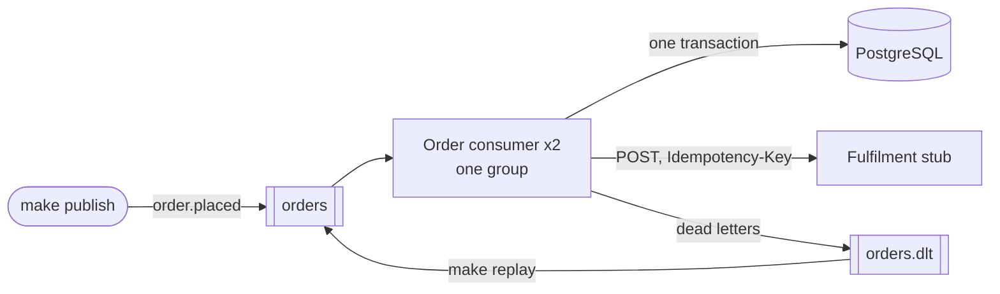

# Task 2: Order event consumer

[](https://github.com/ehmSKah/task-submission/actions/workflows/task2-ci.yml)

A Kafka consumer that reads order placed events, validates and transforms them, stores each order
in PostgreSQL and hands it over to a downstream REST API, a fulfilment service. It is built for
the failure cases:
- **Idempotent end to end:** the order id is the database key and the downstream
  `Idempotency-Key`, so redelivered or re-emitted events never create a second order anywhere.
- **Bounded retries and a dead-letter topic:** five attempts with full jitter, then `orders.dlt`
  with the reason in its headers, and a command to replay it.
- **Safe across crashes, restarts and rebalances:** an offset is committed only once its message
  is done, and every repeat is harmless.
- **Observable:** JSON logs and OpenTelemetry traces share one correlation id, the W3C trace id.

Everything runs locally in Docker Compose: Kafka (KRaft), PostgreSQL, two consumer instances, a
fulfilment stub, kafka-ui and optionally Jaeger. The reasoning is in
[`docs/design.md`](docs/design.md), which summarises the decisions in [`docs/adr/`](docs/adr/).

## Deliverables at a glance

| Assignment item | Where |
|---|---|
| **Consume order events from a Kafka topic using a consumer group** | [`poll_loop.py`](consumer/src/order_consumer/adapters/inbound/poll_loop.py) (our own poll loop, the only place that commits); [`compose.yaml`](compose.yaml) (topic `orders` with 3 partitions, two instances in group `order-consumer`); [design §1](docs/design.md#1-architecture); [ADR 0005](docs/adr/0005-python-stack-and-code-structure.md) |
| **Validate and transform the JSON message** | [`order-placed.v1.schema.json`](schemas/order-placed.v1.schema.json) (the contract); [`validation.py`](consumer/src/order_consumer/domain/validation.py) and [`rules.py`](consumer/src/order_consumer/domain/rules.py) (five layers); [`order.py`](consumer/src/order_consumer/domain/order.py) and [`downstream.py`](consumer/src/order_consumer/domain/downstream.py) (the two mappings); [ADR 0001](docs/adr/0001-order-placed-event-contract.md) |
| **Persist the processed data** | [`postgres_store.py`](consumer/src/order_consumer/adapters/outbound/postgres_store.py); [`db/migrations/`](db/migrations/) (`orders`, `order_lines`, `processed_events`); [ADR 0002](docs/adr/0002-postgres-storage-and-duplicate-detection.md) |
| **Send the transformed data to a downstream REST API** | [`fulfilment_http.py`](consumer/src/order_consumer/adapters/outbound/fulfilment_http.py); [`openapi/fulfilment.yaml`](openapi/fulfilment.yaml) (the contract); [`fulfilment-stub/`](fulfilment-stub/src/fulfilment_stub/app.py) (the stand-in service); [ADR 0003](docs/adr/0003-fulfilment-service-contract-and-stub.md) |
| **Idempotency: no duplicate processing** | [`processing.py`](consumer/src/order_consumer/application/processing.py) (duplicates, conflicts, unfinished handovers); the `orders` primary key and the `Idempotency-Key` header; [design §2](docs/design.md#2-delivery-guarantees); [ADR 0002](docs/adr/0002-postgres-storage-and-duplicate-detection.md), [ADR 0004](docs/adr/0004-inline-handover-and-delivery-guarantee.md) |
| **Retries with a bounded strategy, and a dead-letter topic** | [`retries.py`](consumer/src/order_consumer/application/retries.py); [`flood_guard.py`](consumer/src/order_consumer/application/flood_guard.py); [`kafka_dead_letters.py`](consumer/src/order_consumer/adapters/outbound/kafka_dead_letters.py) (`orders.dlt`); [`replay.py`](consumer/src/order_consumer/replay.py) (`make replay`); [design §3](docs/design.md#3-retry-strategy); [ADR 0006](docs/adr/0006-failures-retries-and-dead-letters.md) |
| **Reliability across restarts and failures** | [`poll_loop.py`](consumer/src/order_consumer/adapters/inbound/poll_loop.py) (commit after the outcome, rebalances, shutdown); [`health.py`](consumer/src/order_consumer/health.py); [`tests/reliability/`](tests/reliability/) and [`test_crash_points.py`](tests/integration/test_crash_points.py); [design §2](docs/design.md#2-delivery-guarantees); [ADR 0004](docs/adr/0004-inline-handover-and-delivery-guarantee.md), [ADR 0007](docs/adr/0007-rebalances-restarts-and-shutdown.md) |
| **Observability: structured logs, correlation IDs, error information** | [`logs.py`](consumer/src/order_consumer/logs.py) (JSON lines, fixed event names, redaction); [`tracing.py`](consumer/src/order_consumer/tracing.py) (`traceparent`, OpenTelemetry); [`test_tracing.py`](tests/integration/test_tracing.py); [design §5](docs/design.md#5-observability); [ADR 0008](docs/adr/0008-observability-tracing-and-logs.md) |
| **Tests: successful processing** | [`tests/integration/test_successful_processing.py`](tests/integration/test_successful_processing.py); unit: [`test_order_mapping.py`](consumer/tests/unit/test_order_mapping.py), [`test_downstream_mapping.py`](consumer/tests/unit/test_downstream_mapping.py), [`test_processing.py`](consumer/tests/unit/test_processing.py) |
| **Tests: invalid messages** | [`tests/integration/test_invalid_messages.py`](tests/integration/test_invalid_messages.py); unit: [`test_event_validation.py`](consumer/tests/unit/test_event_validation.py) (each layer, with property tests) |
| **Tests: duplicate events** | [`tests/integration/test_duplicate_events.py`](tests/integration/test_duplicate_events.py), [`test_crash_points.py`](tests/integration/test_crash_points.py); unit: [`test_order_comparison.py`](consumer/tests/unit/test_order_comparison.py), [`test_fulfilment_stub.py`](fulfilment-stub/tests/test_fulfilment_stub.py) (the stored response) |
| **Tests: downstream API failures** | [`tests/integration/test_downstream_failures.py`](tests/integration/test_downstream_failures.py), [`test_replay.py`](tests/integration/test_replay.py); unit: [`test_retry_policy.py`](consumer/tests/unit/test_retry_policy.py), [`test_flood_guard.py`](consumer/tests/unit/test_flood_guard.py), [`test_fulfilment_http.py`](consumer/tests/unit/test_fulfilment_http.py) |
| **Deliverable: README with setup and execution instructions** | This file: [Quick start](#quick-start), [Tests](#tests), [Troubleshooting](#troubleshooting) |
| **Deliverable: Docker Compose for the local environment** | [`compose.yaml`](compose.yaml) (the stack), [`compose.test.yaml`](compose.test.yaml) (shorter timings for the reliability suite); [`Makefile`](Makefile) (every step); [ADR 0009](docs/adr/0009-local-stack-and-testing.md) |
| **Deliverable: unit and integration tests** | [`consumer/tests/unit/`](consumer/tests/unit/), [`fulfilment-stub/tests/`](fulfilment-stub/tests/), [`tests/integration/`](tests/integration/), plus [`tests/reliability/`](tests/reliability/) ([Tests](#tests)) |
| **Deliverable: brief documentation of the architecture, delivery guarantees, retry strategy and key design decisions** | [`docs/design.md`](docs/design.md) (about four pages), with the ADRs in [`docs/adr/`](docs/adr/) and the glossary in [`CONTEXT.md`](CONTEXT.md) |
| **Local execution only** | Docker Compose on one machine, no cloud account: [Quick start](#quick-start) |

## Quick start

Needs Docker, `make` and `uv` ([versions](#tools)).

```sh
git clone <this repository> && cd <clone>/task2
make up       # builds the images, starts the stack and waits until both consumers consume
make demo     # the assignment's four test categories, live, in about 20 seconds
make test     # every suite: unit, integration, reliability (about 6 minutes)
make down     # stops the stack; `make clean` also deletes its data
```

The first `make up` takes a few minutes: it pulls the images and builds the consumer and the stub.
`make demo` and `make test` run on the host, like `make publish`, so `uv` installs their
dependencies on first use. Start with `make up-tracing` instead of `make up` to see each order's
trace in Jaeger.

| UI | URL | Started by | Shows |
|---|---|---|---|
| kafka-ui | <http://localhost:8080> | `make up` | the topics `orders` and `orders.dlt`, each record with its headers (`traceparent`, `dlt.*`), the consumer group and its lag; read-only |
| Jaeger | <http://localhost:16686> | `make up-tracing` | each order's trace: the message span, each handover attempt and the stub's span inside it, a replay later in the same trace |
| Fulfilment stub | <http://localhost:8081/_control/fulfilment-orders> | `make up` | the fulfilment orders the stub created (JSON), one per order |

`make demo` publishes new orders on every run, so it repeats on the same stack without
`make clean`. Each section ends with the test file that proves it, and the demo stops at the first
outcome that isn't the promised one, printing what it observed:

| Section | What it shows | Proven by |
|---|---|---|
| 1. Successful processing | three orders in EUR, JPY and KWD, stored in minor units and handed over in each currency's decimals (`44.98 EUR`, `4498 JPY`, `4.498 KWD`) | [`test_successful_processing.py`](tests/integration/test_successful_processing.py) |
| 2. Invalid messages | one event per validation layer, each a dead letter naming its layer and first error; nothing stored | [`test_invalid_messages.py`](tests/integration/test_invalid_messages.py) |
| 3. Duplicate events | a redelivery and a re-emission (`order.duplicate`, still one fulfilment order); a conflicting event (a `conflict` dead letter naming `/data/lines` and `/data/total`) | [`test_duplicate_events.py`](tests/integration/test_duplicate_events.py) |
| 4. Downstream API failures | two `503`s then `201`; an order that always gets `503`: five attempts, `handover_failed`, a `retries-exhausted` dead letter; its fault cleared, `make replay` and handed over in the same trace | [`test_downstream_failures.py`](tests/integration/test_downstream_failures.py) |
| Summary | the outcomes counted from the terminal log lines (17 messages, one line each), the run's dead letters by reason, and where to look: kafka-ui, Jaeger (the replayed order's trace), `make psql`, `make ps` | |

It runs on the stack's own timings; only the order that runs out of retries waits for its
backoff. `make demo-tests` runs exactly the four test files.

### Tools

| Tool | Version | Why |
|---|---|---|
| Docker with Compose | Docker 25+, Compose 2.20+ | Runs the stack; the consumers' healthcheck uses `start_interval` |
| `make` | 3.81+ | Every setup and execution step |
| [`uv`](https://docs.astral.sh/uv/) | 0.8+ | Runs the demo, `make publish` and the tests on the host; installs Python 3.13 itself |
| `jq` (optional) | any | Only for the log examples below |

Tested on Linux (x86_64 in CI, aarch64 locally). Every image is pinned in `compose.yaml`.
`make help` lists every target.

## Architecture at a glance



For each event the consumer validates it in five layers, maps it to an order, stores it (order,
lines and the event's id in one transaction), hands it over with the order id as
`Idempotency-Key`, records the fulfilment order id, and only then commits the offset. A crash
anywhere means the event comes back, and every repeat is harmless: the step-by-step sequence with
its crash points is in [design §2](docs/design.md#2-delivery-guarantees).

**What happens when something fails** ([design §3](docs/design.md#3-retry-strategy)):
- **Invalid or conflicting events, rejected handovers:** a dead letter at once.
- **Transient downstream failures:** up to five attempts, then a dead letter.
- **An outage or a bug** that fails order after order: the instance pauses in place and probes
  every 30 s, instead of dead-lettering healthy orders.
- **A wrong token, the database or the dead-letter topic down:** the instance pauses; nothing is
  committed or dead-lettered.

**Observability baseline** ([design §5](docs/design.md#5-observability),
[ADR 0008](docs/adr/0008-observability-tracing-and-logs.md)):
- **Logs:** one JSON line per event on stdout, with fixed event names and the trace id, topic,
  partition, offset, event id and order id. Every message ends in exactly one terminal line:
  `handover.completed`, `order.duplicate` or `dead_letter.written`.
- **Traces:** a span per message and per handover attempt, with the stub's span inside; the trace
  id travels in `traceparent` from the record to the fulfilment service, the database and the dead
  letter.
- **Never logged:** the token, database credentials, bodies and `customer_id`.
- **Not built:** metrics and alerting ([below](#known-limitations-and-deliberate-omissions)).

## Following one order

`make publish` prints each record's order, event and trace ids and where it went:

```console
$ make publish
valid                       order 983d0b91-fb69-46dd-9d2a-702a9f9fb7fc  event 8d02dca9-479d-498d-97bb-ced8cedcf032  trace b63529e4a044ff313ec9d8e0e726cefc  orders/0/7
```

1. **PostgreSQL** (`make psql`): the order, its handover and its trace; every event that arrived
   for it, with its Kafka position.
   ```sql
   SELECT handover_status, fulfilment_order_id, trace_id FROM orders WHERE order_id = '983d0b91-…';
   SELECT event_id, outcome, topic, partition, "offset" FROM processed_events WHERE order_id = '983d0b91-…';
   ```
2. **Jaeger** (with `make up-tracing`): <http://localhost:16686/trace/b63529e4a044ff313ec9d8e0e726cefc>
   shows the message span, each handover attempt with its status and duration, and the stub's
   span inside it.
3. **Logs:** every line of the consumer and the stub for that trace, in order.
   ```sh
   docker compose logs --no-log-prefix consumer fulfilment-stub \
     | grep b63529e4a044ff313ec9d8e0e726cefc | jq -c '{timestamp, service, event}' | sort
   ```
   For this order: `event.received`, `order.accepted`, the stub's `fulfilment_order.created`,
   then `handover.completed`.
4. **kafka-ui:** the record at `orders/0/7` with its `traceparent` header. If the order had been
   dead-lettered, `orders.dlt` would show the original record with `dlt.reason`, `dlt.detail` and
   `dlt.attempts`.

## Publishing and replaying

**Publishing** sends sample events, each a new order with its own `traceparent`. Bodies and
customer ids are never printed.

```sh
make publish                                  # one valid order (EUR)
make publish ARGS="valid --count 5 --currency JPY"
make publish ARGS="business-rule re-emitted"  # one of each kind
make publish ARGS=--help                      # the kinds
```

The kinds are `valid`; one invalid event per validation layer (`unreadable`, `not-a-cloudevent`,
`unsupported-type-or-version`, `schema-violation`, `business-rule`); `redelivered` (the same
record twice), `re-emitted` (the order again under a new event id) and `conflicting` (the order
again with other lines and total).

**Replaying** feeds dead letters back into `orders` once their cause is fixed. It is a dry run
unless `--execute`, and lists every dead letter it selects with what it would do:

```console
$ make replay ARGS="--reason retries-exhausted"
orders.dlt/1/1  retries-exhausted  order 6722bc02-6954-47b1-8ace-5e2b741f8772  2026-10-18T16:58:56.063Z  would replay
dry run: 1 to replay, 0 skipped; --execute publishes them to orders
$ make replay ARGS="--reason retries-exhausted --since 2026-10-18T09:00Z --execute"
```

- **Filters:** `--reason` and `--order-id` (each repeatable), `--since` and `--until` (when the
  dead letter was written). A dead letter must match every kind of filter given.
- **Skipped unless `--force`:** invalid events (other than an unsupported type or version) and
  conflicting events, whose unchanged bytes would fail again.
- **Replay within a day.** A plain `make replay ARGS=--execute` also replays `retries-exhausted`
  dead letters older than a real fulfilment service's idempotency-key window (about a day). Use
  `--since` to stay inside it ([ADR 0004](docs/adr/0004-inline-handover-and-delivery-guarantee.md),
  [ADR 0006](docs/adr/0006-failures-retries-and-dead-letters.md)).
- **Replaying twice is harmless:** the replay republishes the copy, and the consumer skips an
  order already handed over as a duplicate.

**Trying the failure handling by hand.** The circuit breaker and restarts are proven by tests and
stay out of the demo:

```sh
# An outage: orders run out of retries until the circuit opens and the instances pause
docker compose stop fulfilment-stub
make publish ARGS="--count 6"
make ps                                   # within a minute: paused (circuit-open)
docker compose start fulfilment-stub      # within 30 s a probe succeeds and the backlog follows
make replay ARGS="--reason retries-exhausted --since 2026-10-18T09:00Z --execute"   # since the outage began

# A crash mid-stream: nothing lost, nothing handed over twice
make publish ARGS="--count 20" && docker compose kill consumer
make up                                   # restarts the consumers; the stack is otherwise unchanged
curl -s localhost:8081/_control/fulfilment-orders | jq 'group_by(.externalReference) | map(length) | max'   # 1
```

- **The outage's dead letters:** the orders that ran out of retries before the circuit opened
  (up to two per instance) are `retries-exhausted` dead letters, which the replay hands over.
- **Restart with `make up`** (or `make up-tracing`, whichever started the stack). A plain
  `docker compose up` without the tracing endpoint recreates the stub, which forgets its journal.

## Tests

| Suite | Command | Runs against | Proves |
|---|---|---|---|
| Unit | `make test-unit` | plain Python, fakes behind every port, a fake clock | each validation layer and business rule; both mappings, with property tests; duplicate versus conflict; retry policy and backoff; the flood guard; the outcome-to-commit table; the start-up budget check; log redaction; the stub's stored response, `422`, `409` and fault rules; the demo; these documents' links |
| Integration | `make test-integration` | the consumer in the test process, on its own topics, against the stack's Kafka, PostgreSQL and stub | the four assignment categories, one file each; crash points; systemic and unexpected failures; dead-letter contents; replay; trace continuity; no token in logs or spans; one terminal line per message |
| Reliability | `make test-reliability` | the stack's consumer containers | hard kill mid-handover, graceful stop mid-stream, rebalance under load, zombie consumer, pauses during a rebalance; each ends with nothing lost and nothing duplicated downstream |
| Static | `make lint` | the repository | Ruff, mypy (strict), import-linter (no Kafka, PostgreSQL or HTTP in the domain), actionlint |

- **Order:** the unit suite needs no stack. The others need `make up` first; `make test` runs all
  three.
- **The reliability suite** recreates the consumers with [`compose.test.yaml`](compose.test.yaml)
  (a 6 s session timeout, a 5 s probe interval) and puts them back afterwards.
- **No sleeps:** every wait is for a state and fails with the last state it observed.
- **Coverage:** `make test-unit` enforces **≥ 90 %** of `domain` and `application`, with branch
  coverage measured. Adapters are proven by the integration tests.
- **Pass arguments to pytest:** `make test-integration PYTEST_ARGS="-k duplicate -x"`.

**CI** ([`.github/workflows/task2-ci.yml`](../.github/workflows/task2-ci.yml), on every push and
pull request that touches `task2/`):
1. **`static`:** `make lint`.
2. **`unit`:** the unit suite with the coverage gate.
3. **`integration`:** `make up` on a fresh runner, the integration and reliability suites, then
   `make demo` as a smoke test.

Reports and logs are uploaded only after a check that none of the stack's fake secrets appears in
them.

## Configuration

The consumer reads its settings from the environment, set in [`compose.yaml`](compose.yaml), and
refuses to start (exit code 2) when one is invalid or the retry budget doesn't fit the poll
interval. To change one, put it in a `compose.override.yaml` next to `compose.yaml` (Compose reads
it automatically) and run `make up`.

| Setting | Default | What it bounds |
|---|---|---|
| `HANDOVER_MAX_ATTEMPTS` | `5` | attempts per handover, the first included |
| `HANDOVER_BACKOFF_BASE_SECONDS`, `HANDOVER_BACKOFF_CAP_SECONDS` | `1`, `15` | full jitter between 0 and min(cap, base × 2ⁿ) |
| `HANDOVER_RETRY_AFTER_CAP_SECONDS` | `15` | the longest `Retry-After` waited for; a longer one ends the retries |
| `FULFILMENT_CONNECT_TIMEOUT_SECONDS`, `FULFILMENT_READ_TIMEOUT_SECONDS`, `FULFILMENT_ATTEMPT_DEADLINE_SECONDS` | `2`, `5`, `10` | one handover attempt |
| `KAFKA_MAX_POLL_INTERVAL_MS` | `300000` | the retry budget must fit in half of it |
| `KAFKA_SESSION_TIMEOUT_MS` | `45000` | how long a silent member keeps its partitions |
| `CIRCUIT_BREAKER_THRESHOLD` | `3` | consecutive orders out of retries that open the circuit |
| `BUG_GUARD_THRESHOLD` | `5` | consecutive unexpected exceptions that trip the bug guard |
| `PAUSE_PROBE_INTERVAL_SECONDS` | `30` | how often a paused instance tries the message in hand again |
| `PAUSE_EXIT_AFTER_MINUTES` | unset | exit with code 3 when still paused, handing the partitions on |
| `LOG_LEVEL` | `INFO` | `DEBUG` for more |
| `OTEL_EXPORTER_OTLP_ENDPOINT` | unset | where spans go; `make up-tracing` sets it to Jaeger |

**Host ports** are variables of the `Makefile`, for when a port is taken or several stacks share
one Docker daemon: `KAFKA_PORT` (9094), `POSTGRES_PORT` (5432), `STUB_PORT` (8081), `UI_PORT`
(8080) and `JAEGER_UI_PORT` (16686). Compose's own `COMPOSE_PROJECT_NAME` overrides the project
name, `task2`. `STACK_HOST` is the host the published ports are reached on: `localhost`, or the
daemon's host when `DOCKER_HOST` points at a remote one.

## Assumptions

- **Order events are order placements.** The consumer handles one event type, `order.placed`,
  carrying the complete order; there are no updates or cancellations
  ([ADR 0001](docs/adr/0001-order-placed-event-contract.md)).
- **The fulfilment service is a stand-in designed for this assignment.** The assignment names
  only "a downstream REST API", so its contract ([`openapi/fulfilment.yaml`](openapi/fulfilment.yaml))
  is ours, and so is the stub that plays it, with fault rules and a journal for the tests
  ([ADR 0003](docs/adr/0003-fulfilment-service-contract-and-stub.md)).
- **The producer is not designed.** `make publish` and the tests play it.
- **The secrets in `compose.yaml` are fake and committed on purpose:** the fulfilment token and
  the database passwords, all `local-dev-*`, so the stack runs with no setup. CI checks that none
  of them appears in what it uploads.
- **How task1 and task2 would connect:** in a real system task1's Orders API would be the
  producer, publishing an order placed event for each order it creates; the two share no code and
  no runtime link here.

## Project layout

```
task2/
├── schemas/                  # the event contract: order-placed.v1.schema.json
├── openapi/fulfilment.yaml   # the fulfilment service's contract
├── db/                       # SQL migrations (dbmate) and the PostgreSQL image with two roles
├── consumer/                 # the order consumer (its own uv project and image)
│   └── src/order_consumer/
│       ├── domain/           # the event, the order, validation, business rules, both mappings
│       ├── application/      # processing one event, retries, the flood guard, replay; the ports
│       ├── adapters/         # inbound: the poll loop, the dead-letter reader;
│       │                     # outbound: PostgreSQL, fulfilment HTTP, dead letters, republisher
│       └── main.py, replay.py, health.py, logs.py, tracing.py, config.py
├── fulfilment-stub/          # the stand-in fulfilment service (FastAPI, its own image)
├── demo/                     # make demo and make publish
├── tests/                    # integration/, reliability/, docs/ and shared support/
├── docs/                     # design.md and adr/
├── compose.yaml              # the stack; compose.test.yaml for the reliability suite
├── Makefile                  # every setup and execution step; `make help`
└── CONTEXT.md                # the domain glossary
```

## Known limitations and deliberate omissions

These are stated rather than hidden. The full list, with what would change each one, is in
[design §6](docs/design.md#6-production-evolution) and
[ADR 0010](docs/adr/0010-production-evolution.md).

- **Where the delivery guarantee stops**
  ([ADR 0004](docs/adr/0004-inline-handover-and-delivery-guarantee.md)):
  - A dead letter replayed after the fulfilment service has forgotten the idempotency key could
    create a second fulfilment order. The stub never forgets while it runs.
  - Events the producer never wrote, and events older than the topic's 7-day retention, are
    outside it.
  - Dead letters are at-least-once; a second copy is harmless to replay.
- **One broker, no Kafka security:** replication factor 1, plaintext, no authentication.
- **A static bearer token** to the fulfilment service; production would use OAuth2 client
  credentials or mTLS, with secrets from a secret manager.
- **Not built:** metrics, alerting and dashboards. Logs and traces carry every signal; lag, an
  open circuit and dead-letter growth would be the first alerts.
- **Throughput:** one message at a time per instance, with blocking retries, so one order being
  retried holds up its instance's other partitions for up to about a minute.
- **The flood guard's state is in memory:** each restart during an outage lets up to two more
  orders through to the dead-letter topic.
- **The stub keeps its state in memory:** restarting it forgets its keys and journal.
- **Not covered:** erasing one customer's data across orders, dead letters and logs.

## Troubleshooting

- **`make demo` fails in section 1 after pulling a change:** the running stub is older than its
  code. `make up` rebuilds the images (`--build`); run it again.
- **`make demo` or a test reports an outcome it didn't expect:** it prints what it observed last.
  `make ps` shows each consumer's health and, when one is paused, why (`circuit-open`,
  `bug-guard`, `systemic: postgres-unavailable`, …); `make logs` follows every service.
- **A consumer is unhealthy:** it is paused or still starting. A paused instance resumes by itself
  within 30 s of the cause going away; `make ps` names the cause.
- **`make up` times out:** a consumer that can't start keeps restarting. Its log says why, for
  example an invalid setting or a retry budget that doesn't fit (`docker compose logs consumer`).
- **A port is in use:** set the `Makefile` variable for it, e.g. `make up UI_PORT=8180`, and pass
  the same to the other targets ([Configuration](#configuration)).
- **The Docker daemon is remote** (`DOCKER_HOST=tcp://…`): the published ports are on that host,
  which `STACK_HOST` follows; the URLs above then use its name instead of `localhost`.
- **arm64 or amd64:** every image and Python wheel exists for both; CI runs on amd64.
- **Starting from scratch:** `make clean && make up` deletes the topics' and the database's data.
