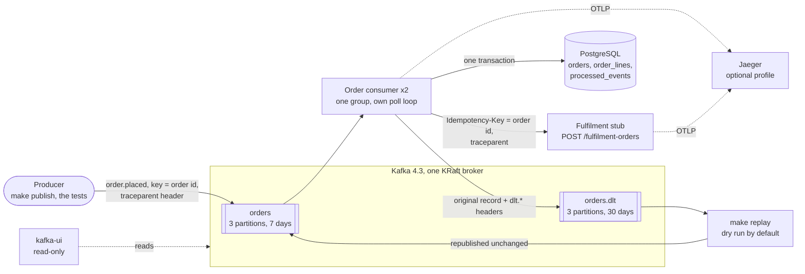
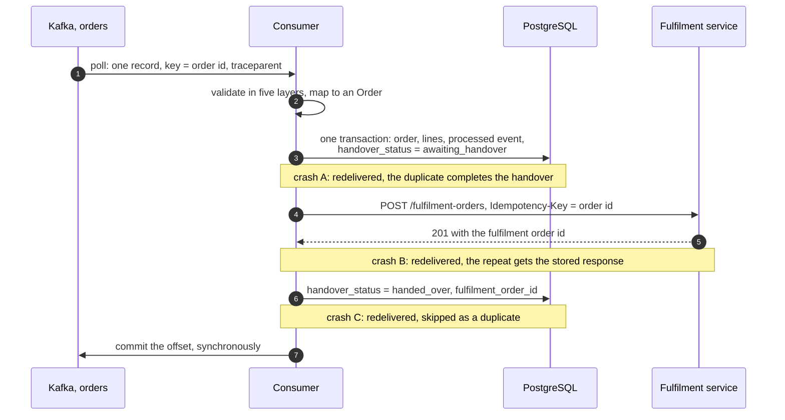
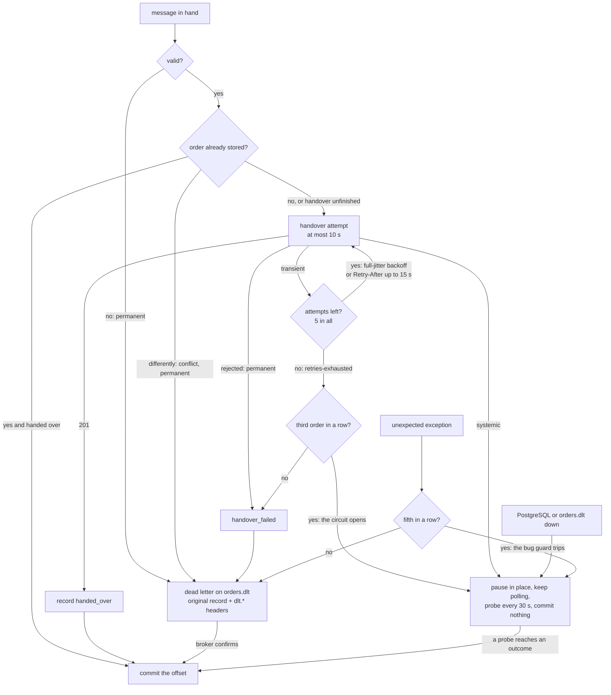

# Order event consumer: design

This document covers the architecture, the delivery guarantees, the retry strategy and the key
design decisions, then observability and how the design would evolve for production. Each section
summarises one or more decisions and links to the ADR that holds the reasoning, the alternatives
and the details. The ADRs ([`adr/`](adr/)) and the glossary ([`CONTEXT.md`](../CONTEXT.md)) go
into more depth.

## 1. Architecture

A consumer group reads **order placed events** from the Kafka topic `orders`, validates and
transforms each one, stores the order in PostgreSQL and **hands it over** to a fulfilment service
over REST. Events it can't process become **dead letters** on `orders.dlt`, from which a command
can **replay** them once the cause is fixed.

**Constraints that shaped the design:**
- It runs on a laptop with Docker Compose only.
- The reliability mechanics (commits, retries, dead letters) are our code, visible and tested,
  not a framework's configuration.
- Nothing may be lost or done twice across crashes, restarts and rebalances, and tests prove it.

- **The event** ([ADR 0001](adr/0001-order-placed-event-contract.md)): one type,
  `order.placed`, in a CloudEvents envelope, keyed by order id, with a `traceparent` header.
  Money is integer minor units; the customer is an id only
  ([`order-placed.v1.schema.json`](../schemas/order-placed.v1.schema.json)).
- **Validation** in five layers, stopping at the first that fails: unreadable, not a CloudEvent,
  unsupported type or version, schema violation, business rule (the total equals the sum of the
  lines, each SKU once, the key equals the order id). An invalid event is **permanent**: it is
  dead-lettered with its layer and errors, never retried.
- **Transformation:** two pure mappings, event → our `Order` (UTC timestamps, derived line
  totals, unknown fields dropped) → the fulfilment request (decimal money in the currency's
  exponent, lines in SKU order). Nothing is silently repaired.
- **Storage** ([ADR 0002](adr/0002-postgres-storage-and-duplicate-detection.md)): `orders`,
  `order_lines` and `processed_events` in one transaction, by a database user that can't change
  the schema; SQL migrations run by a one-shot dbmate service.
- **The fulfilment service** ([ADR 0003](adr/0003-fulfilment-service-contract-and-stub.md)), a
  stand-in we designed ([`fulfilment.yaml`](../openapi/fulfilment.yaml)): `POST
  /fulfilment-orders` with the order id as `Idempotency-Key`, answered `201` with a fulfilment
  order id. A repeat with the same body gets the **stored response** (the same `201` and id),
  another body `422`, a request still in progress `409`. Our FastAPI stub honours that, injects
  faults per order and keeps a journal of the fulfilment orders it created.
- **Code** ([ADR 0005](adr/0005-python-stack-and-code-structure.md)): Python 3.13 on
  `confluent-kafka`, synchronous, one message at a time, ports and adapters. Processing returns an
  `Outcome` and **only the poll loop commits**. Two instances share three partitions (2 + 1).

## 2. Delivery guarantees

[ADR 0004](adr/0004-inline-handover-and-delivery-guarantee.md): storing and handing over are two
writes to two systems, and no transaction spans both. The consumer does them **inline**, and
commits the offset only once the message has reached a terminal outcome. Until then Kafka keeps
the event: **the uncommitted offset is the to-do list.**

| Crash after … | The redelivered event finds | Why it's safe |
|---|---|---|
| storing (A) | the order, handover unfinished | a duplicate **completes** an unfinished handover instead of skipping it |
| the handover (B) | the order, handover unfinished | the repeated `POST` gets the stored response with the same fulfilment order id |
| recording (C) | the order, handed over | skipped and logged: no new effects |

Each row is an integration test with the crash injected at the exact step
([`test_crash_points.py`](../tests/integration/test_crash_points.py)).

- **Committing:** auto-commit off, a synchronous commit per message, `auto.offset.reset=earliest`.
  Handed over, duplicate and dead-lettered (once the broker confirms) are terminal and committed;
  a systemic failure is not. A crash redelivers at most one message.
- **Duplicates** ([ADR 0002](adr/0002-postgres-storage-and-duplicate-detection.md)): the **order
  id is the business key**, the primary key of `orders` and the `Idempotency-Key` downstream. An
  event id alone would catch a redelivery but not a re-emission (the order sent again under a new
  event id). Event ids are recorded too, so the logs tell the two apart. A **conflicting event**
  (the same order, described differently) is dead-lettered with the differing fields; the first
  version wins.

> **The guarantee:** every valid order placed event in the topic leads to exactly one stored order
> and at most one fulfilment order. The fulfilment order is created once the fulfilment service is
> available and any dead letters have been replayed.

Consumption is at-least-once, effects are idempotent, so business operations are
**effectively once**. This is not Kafka's exactly-once, which covers only Kafka.

**Where it stops:**
1. **The fulfilment service's memory of keys.** If an attempt timed out after creating the order
   and the dead letter is replayed after the service forgot the key (typically a day), a second
   fulfilment order is possible. Replay within the window; the fix is a lookup by
   `externalReference` first.
2. **It starts at the topic**, and **ends at Kafka's retention** (7 days for `orders`).
3. **Dead letters are at-least-once**; replaying a second copy is harmless.
4. **Systemic failures delay; they don't lose.**

**Ordering:** one order's events share a partition and are processed in order; nothing depends
on order across partitions, since the only repeat for an order is a harmless duplicate.

**Restarts and rebalances** ([ADR 0007](adr/0007-rebalances-restarts-and-shutdown.md)): on
SIGTERM the consumer finishes the current step, then leaves the group at once. Rebalances use
`cooperative-sticky`; callbacks never commit, and an uncommitted message from a partition that
moved is left to its new owner. A zombie (an instance frozen past its session timeout) can't
duplicate anything: one `orders` insert wins, its handover gets `409` or the stored response, and
its commit is refused. Six reliability scenarios (crash points, hard kill, graceful stop,
rebalance under load, zombie, pause during a rebalance) end with the same two assertions:
**nothing lost** and **nothing duplicated downstream** (one fulfilment order and one `orders` row
per order id).

## 3. Retry strategy

[ADR 0006](adr/0006-failures-retries-and-dead-letters.md): every failure falls into one of four
classes, and the class alone decides what happens.

| Class | Failures | Handling | Offset |
|---|---|---|---|
| **Permanent** | invalid event; conflicting event; handover rejected (`400`, `422`, other `4xx`) | dead-lettered at once, no retries | committed once the dead letter is confirmed |
| **Transient** | connection errors, timeouts, `408`, `429`, `5xx`, `409` in progress | bounded retries; when they run out, `handover_failed` and a `retries-exhausted` dead letter | committed once the dead letter is confirmed |
| **Systemic** | `401`, `403`, `404`, `405`, `415`, `3xx`, an unexpected `2xx`; PostgreSQL unavailable; `orders.dlt` unwritable | consumption **pauses**; nothing is dead-lettered | not committed |
| **Unexpected** | any other exception: a bug for this message | dead-lettered with the exception type; the stack trace goes to the error log | committed once the dead letter is confirmed |

**Bounds.** Retries are blocking: the message stays in hand, which keeps order and the code
simple.

| Setting | Default |
|---|---|
| Attempts per handover | 5 (the first and 4 retries) |
| Backoff | full jitter: random between 0 and min(15 s, 1 s × 2ⁿ) |
| One attempt | 2 s connect, 5 s read, 10 s for the whole attempt; no retries inside the HTTP client |
| `Retry-After` | honoured up to 15 s instead of the backoff; a longer one ends the retries at once |
| Worst case | ≤ 65 s (≤ 110 s if every answer asks for 15 s), under half of Kafka's 300 s poll interval |

- **The budget is checked at start-up:** the consumer refuses to start (exit code 2) if the worst
  case exceeds half of `max.poll.interval.ms`, so no setting can silently cost it its partitions.
- **Only one layer retries;** retries inside the HTTP client would multiply the bound.
- **Accepted cost: head-of-line blocking.** While one order is retried, that instance's other
  partitions wait, about a minute at most. Retry topics or the outbox are the next step if orders
  ever need longer (compared in ADR 0006).

**The flood guard** keeps an outage or a bug from turning healthy orders into dead letters. When
**3 consecutive orders** run out of retries, the circuit opens: the third is held, and the
instance pauses its partitions while **still polling**, so it keeps them however long the outage
lasts. Every 30 s it probes with a single attempt; once the service decides on the order, the
backlog follows in order, with nobody involved. **5 consecutive unexpected exceptions** trip the
bug guard the same way. Invalid and conflicting events never count: bad producer data should fill
the dead-letter topic, not stop valid events. The state is per instance and in memory.

**Dead letters** go to one topic, `orders.dlt`, keyed by order id and kept 30 days (longer than
`orders`: a dead letter is a person's work item). Each is the **original record unchanged**, its
headers included, plus `dlt.reason` (`invalid`, `conflict`, `rejected`, `retries-exhausted`,
`unexpected`), `dlt.detail` (JSON: the layer and errors as JSON Pointers, the differing fields,
the last status and error, or the exception type), `dlt.attempts`, `dlt.source` (topic, partition
and offset), the times, and the event and order ids. Never the token, never a stack trace.

**Replay:** `make replay` lists what it would republish to `orders` (a dry run) and `--execute`
does it, filtered by reason, order id or time. Headers are kept, so a replayed dead letter
continues its trace; processing completes a failed handover or skips one already done. Invalid
and conflicting dead letters are skipped unless `--force`.

## 4. Key design decisions

| ADR | Decision | Chosen | Main alternative | Why |
|---|---|---|---|---|
| [0001](adr/0001-order-placed-event-contract.md) | Event contract, validation, transformation | One `order.placed` type in a CloudEvents envelope; five validation layers, invalid is permanent; three models, two pure mappings | A lifecycle of event types; our own envelope; pass-through | Nothing depends on event order; a standard envelope; a real, testable transformation |
| [0002](adr/0002-postgres-storage-and-duplicate-detection.md) | Storage and duplicate detection | PostgreSQL, order and processed event in one transaction; the order id as business key; first version wins | PostgreSQL + Redis; DynamoDB; the event id as key | Atomic across a crash; catches re-emissions as well as redeliveries; SQL to inspect |
| [0003](adr/0003-fulfilment-service-contract-and-stub.md) | The downstream contract | `POST` with `Idempotency-Key`; four response classes; one retry layer; our own stub | `PUT` by id; WireMock | Idempotency is visible; tests can prove one fulfilment order per order |
| [0004](adr/0004-inline-handover-and-delivery-guarantee.md) | The dual write | Inline: store, hand over, record, commit; the uncommitted offset is the to-do list | Transactional outbox | Correct without a second loop, because every repeat is harmless; retries and dead letters stay in Kafka |
| [0005](adr/0005-python-stack-and-code-structure.md) | Stack and code | Python 3.13, `confluent-kafka`, our own synchronous poll loop, hexagonal | Spring Kafka; FastStream, faust | The reliability mechanics stay in our code; Python's frameworks hide commit timing |
| [0006](adr/0006-failures-retries-and-dead-letters.md) | Failures, retries, dead letters | Four classes; 5 blocking attempts with full jitter, checked at start-up; flood guard; one `orders.dlt`; `make replay` | Retry topics; no flood guard | Bounded within the poll budget; an outage waits in Kafka instead of filling the dead-letter topic |
| [0007](adr/0007-rebalances-restarts-and-shutdown.md) | Rebalances, restarts, shutdown | Finish the step, then leave; `cooperative-sticky`; no commits in callbacks; a heartbeat healthcheck | Finishing the whole message; static membership; KIP-848 | Prompt hand-overs; correctness never depends on finishing |
| [0008](adr/0008-observability-tracing-and-logs.md) | Observability | `traceparent` as the correlation id; OpenTelemetry traces, Jaeger optional; JSON logs with fixed event names | Our own correlation header; metrics and a collector now | A standard id any system joins; one terminal line per message counts outcomes |
| [0009](adr/0009-local-stack-and-testing.md) | Local stack and testing | The Compose stack as the harness; in-process and container tests; one file per test category; no sleeps | Testcontainers | Tests run against the broker image that ships |
| [0010](adr/0010-production-evolution.md) | Production evolution | Simplifications grouped by what triggers them | A flat backlog; a platform sketch | Says what changes when, and why |

## 5. Observability

[ADR 0008](adr/0008-observability-tracing-and-logs.md):
- **The correlation id is the W3C trace id** in the record's `traceparent` header. It is bound to
  every log line and span for the message, sent on every handover attempt, stored on the order and
  kept on dead letters, so a replay continues the original trace. A missing or malformed header
  starts a new trace (`trace_source`: `header`, `new` or `replaced`).
- **Traces** (OpenTelemetry): a span per message, child spans per database write and per handover
  attempt with its status, and the stub's span inside each attempt. Jaeger runs with
  `make up-tracing`; otherwise spans are discarded.
- **Logs:** one JSON line per event on stdout (`structlog`), under fixed event names such as
  `order.accepted`, `handover.attempt_failed`, `dead_letter.written` and `circuit.opened`. Every
  message ends in **exactly one terminal line** (`handover.completed`, `order.duplicate` or
  `dead_letter.written`), so outcomes can be counted from the logs; the demo does.
- **Error information:** each attempt logs its response class, status, error and duration;
  dead letters carry reason, detail and attempts; only `processing.unexpected_error` has a stack
  trace.
- **Never logged, nor a span attribute:** the token, database credentials, bodies and
  `customer_id`. A test hands over with a known token and finds it nowhere.
- **Not built:** metrics; lag, circuit state and dead-letter growth are the first alerts.

## 6. Production evolution

[ADR 0010](adr/0010-production-evolution.md) lists every deliberate simplification by trigger.
**Before go-live**, the top three are a **replicated Kafka** (replication factor 3,
`min.insync.replicas=2`), **Kafka security** (TLS, authenticated clients, ACLs per principal) and
**erasure of one customer's data**, which must reach dead letters as well as the tables. After
those: OAuth2 or mTLS to the fulfilment service, metrics and alerting, retention sized to the
longest tolerated outage, and closing the key-memory gap. **Load** would bring more partitions,
batched commits, parallel processing within a partition, and the outbox or retry topics.
**New requirements**, such as orders that change after placement, would bring snapshot events
with a version guard. Nothing there is built; each item names the ADR it extends.
